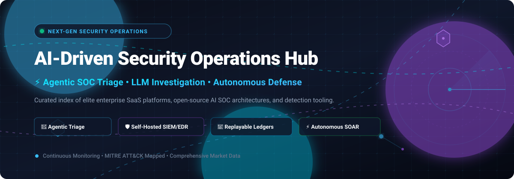

# 🛡️ Awesome AI-Driven Security Operations Hub

  
  
  
  
  

**🌟 The authoritative, production-grade curated index of AI-driven Security Operations Center (AI SOC) platforms, agentic triage tools, LLM-powered incident response suites, and self-hosted open-source detection engineering stacks. 🌟**

[Explore SaaS Platforms](#-saas--hosted-platforms) • [Explore Open-Source Stacks](#-open-source-github-projects) • [Market Dynamics](#-sector-overview--market-dynamics) • [Contributing](#-how-to-contribute) • [Support](#-support)

---

## 📖 Table of Contents

- [🌐 Overview & Ecosystem Architecture](#-overview--ecosystem-architecture)
- [📊 Sector Overview & Market Dynamics](#-sector-overview--market-dynamics)
- [☁️ SaaS / Hosted Platforms](#-saas--hosted-platforms)
- [💻 Open-Source GitHub Projects](#-open-source-github-projects)
- [🤝 How to Contribute](#-how-to-contribute)
- [📈 Star History](#-star-history)
- [💖 Support](#-support)
- [⚖️ Disclaimer](#-disclaimer)

---

## 🌐 Overview & Ecosystem Architecture

Modern Security Operations Centers (SOCs) face unprecedented telemetry scale, persistent alert fatigue, and sophisticated AI-driven threat vectors. The shift toward **AI-Driven Security Operations** empowers cyber defense teams to:

- 🔍 **Ingest & Normalize Heterogeneous Telemetry:** Stream logs from EDRs, identity providers, network firewalls, and cloud infrastructure.
- ⚡ **Automated Alert Fusion & De-duplication:** Correlate disparate telemetry streams into unified, high-fidelity security incidents.
- 🤖 **Agentic Investigation & Decision Ledgers:** Deploy multi-agent LLM systems that execute step-by-step investigations, fetch contextual evidence via graph analysis, and record transparent, tamper-evident audit trails.
- 🎯 **Governed Orchestration & Containment:** Enforce human-in-the-loop approvals for critical response actions (e.g., host isolation, credential revocation) while automating routine triage tasks.

---

## 📊 Sector Overview & Market Dynamics

The global **AI-driven Security Operations (SecOps / AI SOC)** market is estimated at **$18.1B to $28.2B in 2025–2026** and projected to surge past **$71.7B to $82.5B by 2030** at a rapid **~20% to 22% CAGR** (with the broader AI cybersecurity sector crossing **$93B+**).

The market exhibits **moderate fragmentation with aggressive platform consolidation**: hyperscalers and legacy enterprise security giants (Microsoft, Palo Alto Networks, CrowdStrike, Google Cloud) command dominant revenue shares by bundling AI copilots into broader XDR/SIEM ecosystems, while innovative agentic startups and self-hosted open-source stacks rapidly capture developer, homelab, and data-sovereign niche deployments.

---

## ☁️ SaaS / Hosted Platforms

Enterprise-grade AI security platforms providing fully managed agentic triage, adversary intelligence, and cloud-scale security data lakes.

> *Sorted descending by company size (Market Capitalization / Enterprise Valuation).*

| Platform | Company Size (Valuation / Market Cap) | Primary AI SOC Capabilities | Specific Starting Tier Pricing | Free Tier / Trial Limits |
| :--- | :--- | :--- | :--- | :--- |
| [**Microsoft Security Copilot**](https://www.microsoft.com/en-us/security/business/ai-machine-learning/microsoft-security-copilot) | **~$3,150B** (Market Cap) | Generative AI & agentic triage integrated across Microsoft Defender XDR, Sentinel SIEM, and Intune MDM. Natural language incident synthesis and script analysis. | **$4.00 per Security Compute Unit (SCU) / hour** (provisioned baseline; $6.00/SCU/hr on-demand overage) | **Included allowance**: 400 SCUs/month per 1,000 paid user licenses for M365 E5/E7 customers; pay-as-you-go thereafter |
| [**Google SecOps**](https://cloud.google.com/security/products/secops) *(formerly Chronicle)* | **~$2,180B** (Alphabet Market Cap) | Cloud-native hyper-scale SIEM/SOAR powered by Gemini in SecOps for threat detection, playbooks, Mandiant frontline intelligence, and BigQuery UDM analytics. | **$1.95 per GB ingested / year** (Standard package list price; Enterprise with Gemini AI at ~$2.40/GB/yr) | **30-day Google Cloud trial** with $300 cloud credits; includes up to 10 GB/day free ingestion for GCP Audit and Workspace logs |
| [**Palo Alto Cortex XSIAM**](https://www.paloaltonetworks.com/cortex/cortex-xsiam) | **~$110B** (Market Cap) | Autonomous AI-driven SecOps platform consolidating SIEM, SOAR, ASM, and XDR with Precision AI continuous analytics and automated alert grouping. | **£45 to £105 per user/year** (or ~$50–$55/endpoint/yr; third-party ingestion from ~£300/GB tier block list price) | **No perpetual free tier**; Proof of Concept (PoC) available via sales request (typically 30-day scoped enterprise evaluation) |
| [**CrowdStrike Charlotte AI**](https://www.crowdstrike.com/products/falcon-platform/charlotte-ai/) | **~$80B** (Market Cap) | Agentic AI within Falcon platform. Correlates detections against real-time adversary intelligence, threat graphs, and automates multi-stage remediation. | **$20.00+ per endpoint / year** (list price add-on; requires Falcon base tier starting at $59.99/device/yr for Falcon Go) | **Baseline allotment**: Qualifying Falcon console customers receive ~50 free AI investigation queries/month; 15-day Falcon trial |
| [**Databricks Mosaic AI**](https://www.databricks.com/product/machine-learning) | **~$43B** (Valuation) | Data intelligence platform enabling custom security data lakehouses, agentic triage workflows, and custom LLM evaluation with HIPAA/SOC 2 compliance. | **$0.35 per DBU** (Serverless Jobs compute; Serverless SQL data warehouse from $0.70/DBU; Interactive from $0.75/DBU) | **14-day free trial** with **$400 in serverless usage credits**; plus **Databricks Free Edition** with limited daily serverless compute |
| [**Scale AI**](https://scale.com/) | **~$14B** (Valuation) | Enterprise data curation, model evaluation, RLHF fine-tuning, and automated dataset benchmarking for security-focused foundation models. | **$0.05 per labeling unit** (Self-serve Rapid Annotation Engine; enterprise custom tiers from mid-5-figure commitments) | **200 free labeling units / month** forever on self-serve; Nucleus dataset curation tool features perpetual free tier for small datasets |
| [**Hugging Face Enterprise**](https://huggingface.co/enterprise) | **~$4.5B** (Valuation) | Central AI hub for hosting sovereign LLMs, custom cybersecurity model checkpoints, inference endpoints, and enterprise RBAC/SSO governance. | **$20.00 / user / month** (Team plan with 1 TB private storage per seat, 40 min ZeroGPU/day, 3,000 API req/5 min) | **Perpetual Free Plan** with unlimited public repositories, Community ZeroGPU compute, and basic model/dataset hosting |
| [**Druva DruAI**](https://www.druva.com/products/druai) | **~$2B** (Valuation) | Agentic AI for enterprise data security and backup operations. Deep Analysis Agents synthesize multi-system forensics into consolidated reports in under 10 minutes. | **$8.00 per user / month** (Baseline Endpoint / SaaS protection starting tier list price; volume infrastructure backup per TB/mo) | **30-day full-featured free trial** with automated backup testing and in-product chat support (no credit card required) |
| [**H2O.ai h2oGPTe**](https://h2o.ai/platform/h2ogpte/) | **~$1.7B** (Valuation) | Sovereign enterprise agentic AI and RAG platform with multimodal document AI, vision, guardrails, and air-gapped FedRAMP High deployment support. | **$150.00+ per GPU / hour or custom annual contract** (Enterprise deployments quoted based on dedicated air-gapped infrastructure) | **Perpetual Freemium tier** on H2O.ai Cloud with limited collections, documents, and daily chat quotas (no sharing across teams) |

---

## 💻 Open-Source GitHub Projects

Production-grade, self-hostable tools, SIEM/EDR platforms, behavioral analytics engines, and AI-native agentic SOC architectures.

> *Sorted descending by GitHub Star Count.*

| Repository | GitHub Stars Badge | Core Tech Stack | License | Key AI & Security Features |
| :--- | :--- | :--- | :--- | :--- |
| [**Wazuh**](https://github.com/wazuh/wazuh) |  | C, Python, OpenSearch | GPL-2.0 | Comprehensive open-source SIEM/XDR with endpoint security agents, regulatory compliance monitoring, vulnerability detection, and active automated response. |
| [**CrowdSec**](https://github.com/crowdsecurity/crowdsec) |  | Go, C | MIT | Collaborative, lightweight intrusion prevention engine that analyzes local behavior and leverages global crowd-sourced threat intelligence networks to block attacks. |
| [**Sigma Rules**](https://github.com/SigmaHQ/sigma) |  | Python, YAML | CC-BY-4.0 | Generic and open detection rule format for SIEM/EDR systems; converts standardized detection logic directly into Splunk, OpenSearch, Microsoft Sentinel, and QRadar queries. |
| [**OpenCTI**](https://github.com/OpenCTI-Platform/opencti) |  | TypeScript, Python, GraphQL | Apache-2.0 | Enterprise-grade cyber threat intelligence (CTI) management platform with STIX 2.1 mapping, automated relationship visualizers, and threat feed orchestration. |
| [**AiSOC**](https://github.com/beenuar/AiSOC) |  | Python, FastAPI, LangGraph, Ollama | MIT | **Fully self-hosted AI SOC**: 833 executable detection rules, sliding-window fusion, multi-agent triage, hash-chained **Investigation Ledger**, and zero-API-key local Llama-3.2 inference. |
| [**Security Onion**](https://github.com/Security-Onion-Solutions/securityonion) |  | Linux, Suricata, Zeek, Elastic | GPL-2.0 | Full-featured platform for threat hunting, enterprise network security monitoring (NSM), packet capture analysis, and log management. |
| [**TheHive**](https://github.com/TheHive-Project/TheHive) |  | Scala, Play Framework, Cassandra | AGPL-3.0 | Scalable, open-source Security Incident Response Platform (SIRP) tightly coupled with MISP and Cortex for task automation and evidence tracking. |
| [**Shuffle SOAR**](https://github.com/Shuffle/Shuffle) |  | Go, Python, React | AGPL-3.0 | Open-source Security Orchestration, Automation, and Response (SOAR) platform with visual drag-and-drop workflow builder and automated webhook triggers. |
| [**Agentic SOC Platform**](https://github.com/FunnyWolf/agentic-soc-platform) |  | Python, Vue | Apache-2.0 | Agent-centric automated security operations platform designed for autonomous alert correlation, agentic triage chains, and multi-model LLM verification. |
| [**Argus Agentic SOC**](https://github.com/Sec-Link/Argus-Agentic-SOC-Platform) |  | Python, LangChain, React | Apache-2.0 | AI-native autonomous SOC platform utilizing specialized LLM agent personas for alert intake, evidence collection, IOC verification, and ticket synthesis. |
| [**Tenzir**](https://github.com/tenzir/tenzir) |  | C++, Python, Arrow | Apache-2.0 | High-throughput data pipeline and security data lake engine designed for filtering, shaping, and transforming security telemetry before ingestion. |
| [**UTMStack**](https://github.com/utmstack/UTMStack) |  | Python, Node.js, Docker | GPL-3.0 | Unified SIEM, SOAR, and compliance monitoring suite supporting real-time log correlation, automated remediation, and SOC 2/ISO compliance tracking. |
| [**OpenUBA**](https://github.com/GACWR/OpenUBA) |  | Python, scikit-learn | Apache-2.0 | Focused User & Entity Behavior Analytics (UEBA) framework for unsupervised anomaly detection, insider threat detection, and baseline modeling. |
| [**Sentora**](https://github.com/d3vhex/Sentora) |  | Python, Sanic, React, Ollama | MIT | Air-gap capable, self-hosted AI-driven SIEM, EDR, and SOAR stack with local Ollama triage models, dynamic Sigma endpoint rules, and fleet exposure auditing. |

---

## 🤝 How to Contribute

Contributions, reviews, and corrections are warmly welcomed! 💡

1. 🍴 **Fork the Repository** on GitHub.
2. 🌿 **Create a Feature Branch** (`git checkout -b feature/add-new-soc-tool`).
3. 📝 **Add or Update Entries**:
   - For SaaS products: include verified starting tier pricing, specific free tier/trial limits, and company size.
   - For Open-Source projects: include the GitHub stars social badge linked to stargazers, core tech stack, license, and actionable features.
4. 🚀 **Commit your Changes** (`git commit -m "feat: add NewTool to Open-Source section"`).
5. 📤 **Push to your Branch** (`git push origin feature/add-new-soc-tool`).
6. 🎯 **Open a Pull Request** with a concise description of your additions.

---

## 📈 Star History

---

## 💖 Support

Thank you for exploring and supporting **Awesome AI-Driven Security Operations Hub**! 🙏

If you find this repository valuable for your security research, SOC engineering, or organization:
- ⭐ **Star this repository** to help others discover it.
- 🍴 **Fork it** to customize it for your internal security team.
- 📢 **Share it** with fellow SOC analysts, detection engineers, and SecOps architects.
- ☕ **Sponsor / Buy me a coffee**: Support ongoing curation and research via the [GitHub Sponsors Dashboard](https://github.com/sponsors/ishandutta2007).

---

## ⚖️ Disclaimer

- This curated list is maintained for educational and operational research purposes only. Mention of third-party products does not constitute an official endorsement.
- Automated security operations tools handling sensitive production logs, telemetry, and personal identity data must strictly comply with regional data protection and privacy regulations (including GDPR, HIPAA, SOC 2, and CCPA).
- Self-hosted open-source security software requires proper operational isolation, host hardening, access management, and ongoing updates before handling enterprise production workloads.

---

  Built with ❤️ for SOC analysts, security engineers, and detection teams worldwide.

